# Cloud Native Taskboard — Bálint Dániel Bank (V90WCP)

A production-style, cloud-native task board built as a university assignment for the Cloud Infrastructure course. The application is intentionally small — the project's real subject is the **infrastructure-as-code**, **CI/CD**, and **security model** around it. Everything below the `services/` boundary (provisioning, networking, secrets, deploy automation) is the part being graded; the app is just realistic enough to exercise it.

Live: <https://cloud-native-taskboard.hu>

---

## Table of contents

1. [Summary](#1-summary)
2. [Architecture](#2-architecture)
3. [Application](#3-application)
4. [Infrastructure as Code](#4-infrastructure-as-code-iac)
5. [CI/CD](#5-cicd)
6. [Further improvement](#6-further-improvement)

---

## 1. Summary

**Taskboard** is a Trello-like multi-user board application: users register, log in, create boards, customise columns, and add tasks (with deadlines, assignees, and subtasks). It is built as **three Go microservices** behind a Go **API gateway**, plus a **React + Vite + shadcn/ui** single-page frontend. Persistence is **Cloud SQL for PostgreSQL 15**, accessed only over a **private VPC peering** link. The runtime is **GKE Autopilot** in a **private** cluster, exposed to the internet by a single **HTTPS Global Load Balancer** with a **Google-managed TLS certificate**.

The entire cloud environment is provisioned by **OpenTofu** (MPL-2.0 open-source fork of Terraform) from a single command, with state in a versioned **GCS bucket**. Kubernetes topology lives in plain YAML under [manifests/](manifests/) and is applied by a GitHub Actions workflow. Application images are built and rolled out by a second GitHub Actions workflow. Both pipelines authenticate to GCP via **Workload Identity Federation** — no service account key ever exists on disk, on GitHub, or in any environment variable.

**Secrets** (the database password and JWT signing key) never appear in OpenTofu state, in a Kubernetes `Secret` object, or in CI variables. Terraform creates only empty Secret Manager *containers*; real values are seeded once via a script and mounted directly into pods from Secret Manager by the **GKE Secret Manager CSI driver**, using Workload Identity. The CI service account can rotate secrets but cannot read them.

### Highlights graded against the rubric

| Requirement                       | How it is met                                                              |
| --------------------------------- | -------------------------------------------------------------------------- |
| Web frontend + backend database   | React SPA + Go services + Cloud SQL Postgres                               |
| IaC, one-command provisioning     | `tofu apply` brings up VPC, GKE, DB, registry, IAM, DNS, TLS-ready Ingress |
| Auto CI/CD on push                | GitHub Actions: detect-changed-service → test → build → deploy             |
| Cloud platform                    | Google Cloud Platform (GKE Autopilot)                                      |
| Realistic security boundary       | Private cluster, private DB IP, WIF, CSI-mounted secrets, least-priv IAM   |
| Inter-service comms / discovery   | tasks-service ↔ users-service via cluster-internal DNS                     |
| Custom domain + TLS               | Cloud DNS-managed `cloud-native-taskboard.hu` + GCP `ManagedCertificate`   |

---

## 2. Architecture

### High-level diagram

```
                                  Internet
                                     │
                                     │  HTTPS (443) only
                                     ▼
                       ┌──────────────────────────────┐
                       │  GCP Global HTTPS LB         │
                       │  • Static IP (taskboard-ip)  │
                       │  • ManagedCertificate (TLS)  │
                       │  • Cloud DNS A records       │
                       │    cloud-native-taskboard.hu │
                       └──────────────┬───────────────┘
                                      │
        ┌─────────────────────────────┼─────────────────────────────┐
        │  GKE Autopilot — private cluster (no public node IPs)     │
        │  Namespace: taskboard                                     │
        │                                                           │
        │   ┌─────────────┐                                         │
        │   │  frontend   │ (nginx serving the React SPA;           │
        │   │  Deployment │  proxies /api/* → api-gateway)          │
        │   └──────┬──────┘                                         │
        │          │                                                │
        │          ▼                                                │
        │   ┌────────────────┐  ← validates JWT (HS256)             │
        │   │  api-gateway   │    key mounted from Secret Manager   │
        │   │  Deployment    │  → injects X-User-ID                 │
        │   └───┬────────┬───┘    strips client-supplied header     │
        │       │        │                                          │
        │       ▼        ▼                                          │
        │ ┌────────┐ ┌────────┐   tasks → users RPC                 │
        │ │ users  │ │ tasks  │ ◄── (assignee validation,           │
        │ │  svc   │ │  svc   │     cluster DNS service discovery)  │
        │ └───┬────┘ └───┬────┘                                     │
        │     │          │                                          │
        │     │  pods mount Secret Manager values via CSI driver    │
        │     │  using Workload Identity (taskboard-pods GSA)       │
        │     │                                                     │
        └─────┼──────────┼─────────────────────────────────────────-┘
              │          │
              │  Private Service Access (VPC peering, no public path)
              ▼          ▼
       ┌──────────────────────┐         ┌──────────────────────┐
       │  Cloud SQL Postgres  │         │   Secret Manager     │
       │  • Private IP only   │         │   • db-password      │
       │  • Automated backups │         │   • jwt-signing-key  │
       └──────────────────────┘         └──────────────────────┘
                                                  ▲
                                                  │  WIF: GitHub Actions
                                                  │  can add new versions
                                                  │  but cannot read
                                          ┌───────┴────────┐
                                          │ GitHub Actions │
                                          │  (deploy + WIF)│
                                          └────────────────┘
```

### What is used and why

| Component                | Choice                                                 | Why                                                                                                                                                                       |
| ------------------------ | ------------------------------------------------------ | ------------------------------------------------------------------------------------------------------------------------------------------------------------------------- |
| **Cloud provider**       | Google Cloud Platform                                  | Free tier + $300 trial credit comfortably covers the project; rich managed building blocks (GKE Autopilot, Cloud SQL, Secret Manager) that map cleanly to course material.|
| **Compute**              | GKE Autopilot (private cluster)                        | Microservices benefit from K8s-style service discovery and rolling updates; Autopilot offloads node management to Google so the project can focus on workloads.           |
| **Database**             | Cloud SQL for PostgreSQL 15, private IP only           | DBaaS gives backups, patching, HA on demand; private IP enforces a real network boundary — the DB is unreachable from the internet.                                       |
| **Container registry**   | Artifact Registry                                      | Native GCP service, IAM-controlled image pulls, regional locality.                                                                                                        |
| **IaC**                  | OpenTofu (≥ 1.7) with GCS state backend                | MPL-2.0 open-source fork of Terraform under the Linux Foundation; identical HCL and provider ecosystem; state bucket has versioning enabled.                              |
| **CI/CD**                | GitHub Actions                                         | Native to where the code lives, free for public repos, first-class OIDC support for keyless auth.                                                                         |
| **Auth GitHub ↔ GCP**    | Workload Identity Federation                           | No long-lived service account keys to leak or rotate; trust is pinned to one specific repository.                                                                         |
| **Secrets**              | Google Secret Manager + GKE Secret Manager CSI driver  | Values never enter tfstate or a K8s `Secret` object; pods mount them as files via Workload Identity; rotatable without redeploying images.                                |
| **DNS**                  | Cloud DNS managed zone + A records                     | Lets Terraform manage the public domain; only the NS hand-off at the `.hu` registrar is a one-time manual step.                                                           |
| **TLS**                  | GCP `ManagedCertificate` on the Ingress                | No cert-manager / Let's Encrypt plumbing; Google provisions and rotates the cert automatically.                                                                           |
| **App auth**             | JWT (HS256) at the gateway + bcrypt cost 12 passwords  | Single trust boundary, stateless tokens, OWASP-recommended hashing.                                                                                                       |
| **Frontend tooling**     | React + Vite + Tailwind v3 + shadcn/ui                 | shadcn/ui components are copied into the repo → zero runtime dependency, accessible defaults out of the box.                                                              |
| **Image tagging**        | Immutable `:<git-sha>` tags                            | Every deploy is traceable to a commit; `kubectl rollout undo` becomes trivial.                                                                                            |

### Trust boundaries and request flow

1. **Internet → LB → frontend.** Only `:443` is exposed. The static IP and TLS cert are pinned by name from the Ingress.
2. **Frontend → api-gateway.** nginx proxies `/api/*` to the gateway over the cluster network.
3. **Gateway = single JWT validator.** It verifies the `Authorization: Bearer …` header against the HS256 key loaded from Secret Manager, **strips any client-supplied `X-User-ID`**, and writes the trusted user id into `X-User-ID` before forwarding.
4. **Backend services trust `X-User-ID`.** They are `ClusterIP`-only and have no route from the internet, so the gateway header is the only entry point. tasks-service then walks `subtask → task → column → board.owner_id` for every read/write and returns `404` (not `403`) on a mismatch to avoid leaking resource existence.
5. **DB and Secret Manager.** Reachable only from inside the VPC. The DB lives behind Private Service Access (VPC peering); Secret Manager is fetched by the CSI driver authenticating as the `taskboard-pods` GSA via Workload Identity.

---

## 3. Application

The application layer is intentionally lightweight — the project is graded on the cloud and CI/CD work surrounding it.

### Services

| Service        | Stack                                            | Responsibility                                                              |
| -------------- | ------------------------------------------------ | --------------------------------------------------------------------------- |
| `api-gateway`  | Go (stdlib `net/http`, `golang-jwt/jwt/v5`)      | The only internet-facing backend pod. Validates JWTs, injects `X-User-ID`, reverse-proxies to the right service. |
| `users-service`| Go (`net/http`, `pgx/v5`, `bcrypt`, `jwt/v5`)    | Owns the `users` table. Handles register, login (issues JWTs), profile read. |
| `tasks-service`| Go (`net/http`, `pgx/v5`)                        | Owns `boards`, `board_columns`, `tasks`, `subtasks`. Enforces per-resource ownership. Calls users-service to validate assignees. |
| `frontend`     | React 18 + Vite + TypeScript + Tailwind v3 + shadcn/ui, served by nginx | SPA: login/register, board list, board detail with drag-friendly columns, task modal with subtasks + deadline. Stores JWT in `localStorage`. |

### User interface

A quick walk through what the deployed app looks like at <https://cloud-native-taskboard.hu>.

The **sign-in page** — the JWT issued here is what every subsequent request carries as `Authorization: Bearer …`:

<p align="center">
  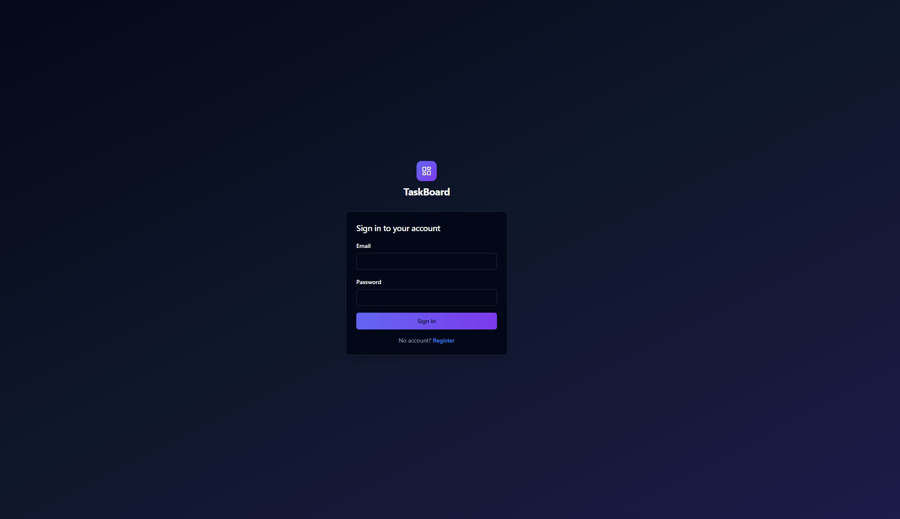
</p>

After login, the **My Boards** landing page lists every board the current user owns. Boards owned by another user are not returned by the API at all (tasks-service walks `board.owner_id` and returns `404` on a mismatch), so there is nothing for the frontend to filter:

<p align="center">
  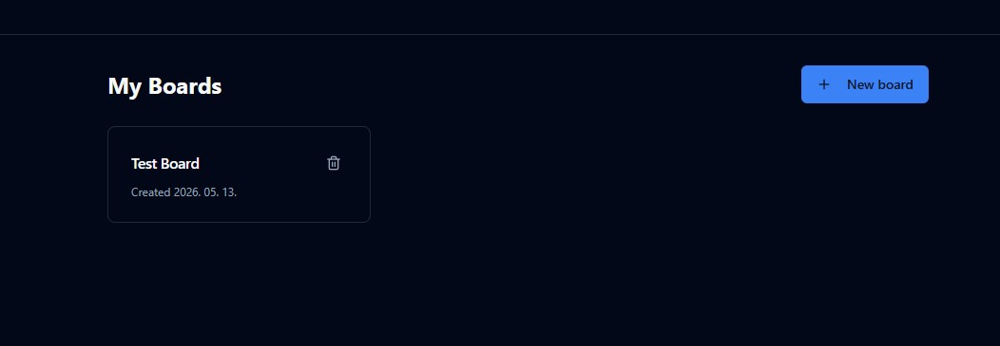
</p>

A **board view** with custom columns, per-task priority badges, deadline chips (with overdue / due-soon highlighting), and the 1–10 column rule enforced server-side:

<p align="center">
  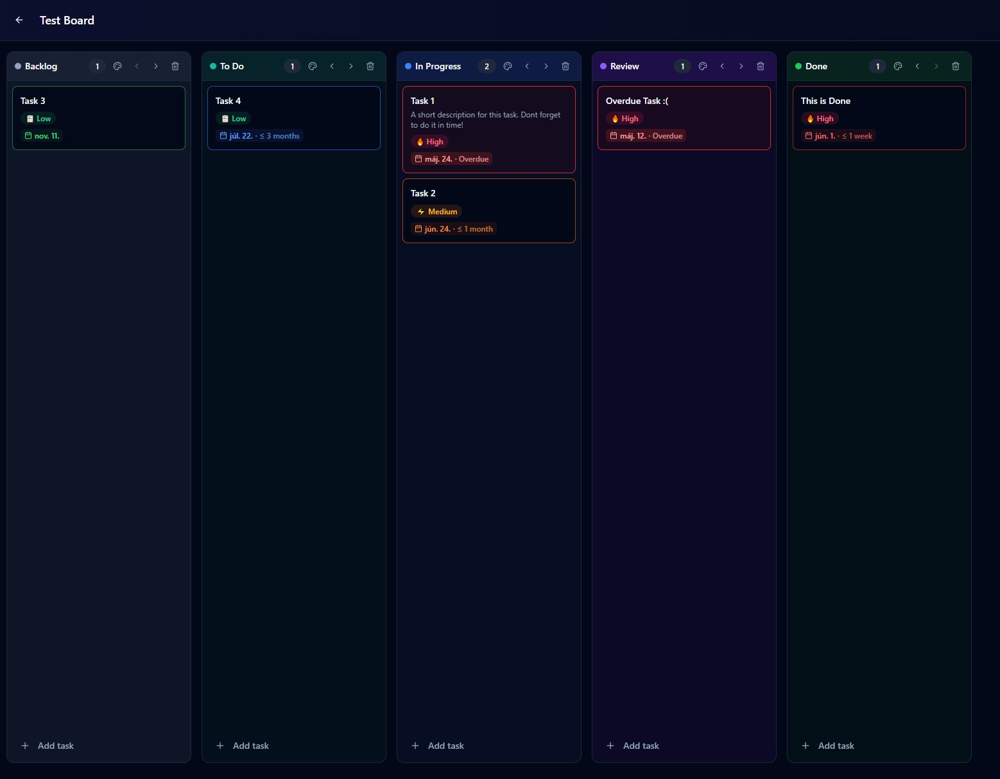
</p>

The **New task modal** — priority + deadline are optional; on submit the frontend POSTs to `/api/columns/{id}/tasks` through the gateway, which validates the JWT before forwarding to tasks-service:

<p align="center">
  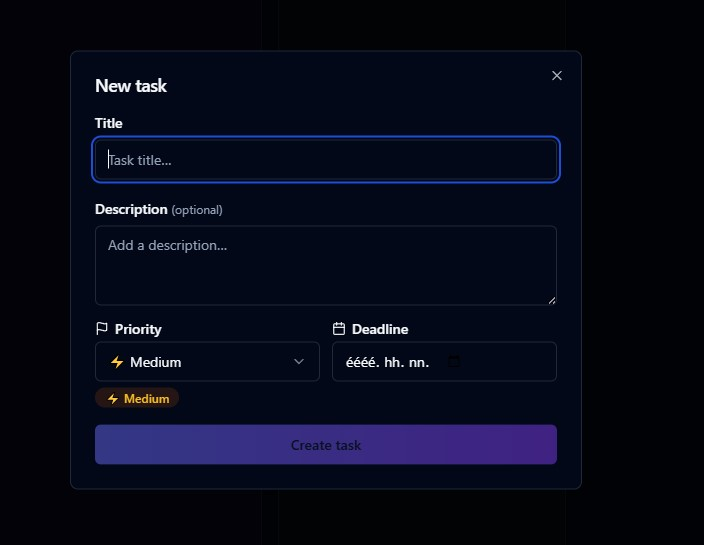
</p>

All Go services share the same skeleton: stdlib `net/http`, multi-stage Dockerfile producing a ~15 MB distroless image, `/healthz` endpoint wired into liveness + readiness probes, and a `secretValue` helper that reads `<NAME>_FILE` in prod (CSI mount) and falls back to `<NAME>` in dev (`docker compose up`). The same Go binary runs locally and in cluster — the secret source is the only thing that changes.

### Data model (summary)

```
users
  └─ boards (owner_id)
       └─ board_columns (board_id)
            └─ tasks (column_id)
                 └─ subtasks (parent_task_id)   — one level only, no recursion
```

A few invariants are enforced in Go (not as SQL constraints) because they're easier to give clean HTTP error responses for: a board always has between 1 and 10 columns, a column with tasks cannot be deleted, and `assigned_user_id` is checked against users-service before writes.

### Tests

Each Go service ships a small `go test ./...` suite. These tests are **deliberately minimal** — their job is not exhaustive coverage of business logic but to give the CI/CD pipeline a meaningful gate before an image is built and pushed. A failing test stops the workflow before `docker build`, so a broken commit never makes it to Artifact Registry, let alone to the cluster. The Postgres-touching tests run against an ephemeral Postgres 15 service container spun up by the GitHub Actions job (see [.github/workflows/deploy.yml](.github/workflows/deploy.yml)), so the test environment matches production.

### Containerization

Every component in the project is delivered as a container image — there are no host-installed runtimes anywhere in the pipeline. The same Dockerfiles are used in local dev (via `docker compose`) and in production (built and pushed by GitHub Actions, run by GKE).

**Go services** — multi-stage build that produces a tiny, hardened final image:

```dockerfile
FROM golang:1.23-alpine AS build
WORKDIR /src
COPY go.mod go.sum ./
RUN go mod download                     # cached layer — only invalidated on dep changes
COPY . .
RUN CGO_ENABLED=0 go build -o /app ./cmd/server

FROM gcr.io/distroless/static:nonroot   # ~2 MB base, no shell, no package manager
COPY --from=build /app /app
USER nonroot:nonroot                    # runs as UID 65532, not root
EXPOSE 8080
ENTRYPOINT ["/app"]
```

The final image is ~15–20 MB, has no shell or libc, and runs as a non-root user. That removes a large class of post-exploitation primitives (no `bash`, no `apt`, no writable filesystem) and keeps cold-start fast on Autopilot, where the kubelet has to pull the image onto a freshly-scheduled node.

**Frontend** — also multi-stage. Vite builds the React SPA in a Node image; the static `dist/` is then copied into a slim nginx image that serves the files and proxies `/api/*` to the gateway.

```dockerfile
FROM node:20-alpine AS build
WORKDIR /app
COPY package*.json ./
RUN npm ci
COPY . .
RUN npm run build

FROM nginx:alpine
COPY --from=build /app/dist /usr/share/nginx/html
COPY nginx.conf /etc/nginx/conf.d/default.conf
EXPOSE 80
```

#### Local development

`docker compose up` brings up the entire stack on `http://localhost:8080` in one command — Postgres (with [db/init.sql](db/init.sql) auto-applied via the official image's init hook), all three Go services, the frontend, and the network between them. Postgres is health-checked so the services wait for it before starting; secrets are plain dev-only env vars (`dev`, `dev-only-not-for-prod-please-rotate`). `docker compose down -v` tears everything down and deletes the volume so the next start is clean.

The `secretValue` helper in each Go service is what makes the *same* binary work in both environments: in dev it reads `DB_PASSWORD` from the env directly; in prod the manifests set `DB_PASSWORD_FILE=/mnt/secrets-store/db-password` (a file written by the CSI driver from Secret Manager) and the helper reads it from there. No `if env == "prod"` branches in the application code.

#### Production

Images are built by the CI runner, tagged with the **exact git SHA**, and pushed to **Artifact Registry** under `europe-west1-docker.pkg.dev/<project>/taskboard/<service>:<sha>`. GKE pulls them onto Autopilot nodes using the cluster's default Artifact Registry IAM binding — no `imagePullSecret` is needed.

Every Deployment specifies `livenessProbe` and `readinessProbe` against `/healthz`, so a container that fails to come up is restarted automatically and is not routed traffic until it's ready. Combined with `kubectl rollout status --timeout=5m` in the deploy workflow, this means a broken image fails the CI job rather than silently degrading the live service.

### Repository layout

```
.
├── services/             4 service directories — each with its own Dockerfile
│   ├── api-gateway/
│   ├── users-service/
│   ├── tasks-service/
│   └── frontend/
├── terraform/            OpenTofu modules — see section 4
├── manifests/            Kubernetes YAML — see section 4
├── scripts/
│   └── bootstrap-secrets.sh   one-shot seeding of Secret Manager values
├── db/init.sql           schema for local Postgres
├── docker-compose.yml    local dev stack
└── .github/workflows/    CI/CD — see section 5
```

---

## 4. Infrastructure as Code (IaC)

All cloud infrastructure is provisioned by **OpenTofu**. Kubernetes workload topology is plain **kustomized YAML**. The two are deliberately separated so that infra (slow, rare, dangerous) and workloads (fast, frequent, low-risk) have different blast radii and different review cadences.

### `terraform/` — what each file does

| File             | Provisions                                                                                                                                                                                                                                          |
| ---------------- | --------------------------------------------------------------------------------------------------------------------------------------------------------------------------------------------------------------------------------------------------- |
| `main.tf`        | Provider config (`hashicorp/google` and `google-beta`, both `~> 5.0`) and the **GCS backend** for state. The state bucket is the one piece of infra that cannot bootstrap itself — it is created once manually and passed in via `-backend-config`. |
| `variables.tf`   | Inputs: `project_id`, `region` (default `europe-west1`), `state_bucket`, `github_repo`, `domain_name`.                                                                                                                                              |
| `outputs.tf`     | Values used by CI and the operator: cluster name and region, Artifact Registry URL, **WIF provider** + deployer SA email (set as GitHub Actions variables), pod runtime GSA email, the static Ingress IP, Cloud SQL private IP, DNS nameservers.    |
| `network.tf`     | The VPC, a single subnet with secondary ranges for GKE pods and services, **Private Service Access** (`google_compute_global_address` + `google_service_networking_connection`) so Cloud SQL can be reached over peering, the static global Ingress IP, and the **Cloud DNS** managed zone + A records for `cloud-native-taskboard.hu` / `www`. |
| `gke.tf`         | **GKE Autopilot** cluster in the `REGULAR` release channel, private nodes, and the **Secret Manager CSI addon** enabled (`secret_manager_config.enabled = true`).                                                                                   |
| `database.tf`    | Cloud SQL Postgres 15 (`db-f1-micro`) with public IP disabled, backups enabled, and the database + app user. **Empty** Secret Manager containers for `db-password` and `jwt-signing-key` — no `random_password`, no `secret_version` resources.     |
| `registry.tf`    | A single Artifact Registry Docker repository named `taskboard` in the same region.                                                                                                                                                                  |
| `iam.tf`         | The full IAM story (see below): the WIF pool + provider pinned to this repository, the narrow `github-deployer` SA used by CI, and the `taskboard-pods` GSA pods authenticate as via Workload Identity.                                             |
| `terraform.tfvars`| Local-only project values (gitignored as needed).                                                                                                                                                                                                  |
| `EXPLAINER.md`   | Long-form architectural rationale kept alongside the code.                                                                                                                                                                                          |

### `manifests/` — flat Kustomize tree

| File                       | Purpose                                                                                                                            |
| -------------------------- | ---------------------------------------------------------------------------------------------------------------------------------- |
| `kustomization.yaml`       | Lists resources in apply order; pins `namespace: taskboard`.                                                                       |
| `namespace.yaml`           | The `taskboard` Namespace plus the `taskboard-pods` KSA, annotated with `iam.gke.io/gcp-service-account` for Workload Identity.   |
| `configmap.yaml`           | Non-secret runtime config: DB host/port/name/user and inter-service URLs (`http://users-service.taskboard.svc.cluster.local:8080`). |
| `secretproviderclass.yaml` | The CSI driver config that tells GKE to pull `db-password` and `jwt-signing-key` from Secret Manager and write them to `/mnt/secrets-store/<name>`. |
| `deployments.yaml`         | All four Deployments. Each pod mounts the CSI volume read-only; only the services that need a secret reference the matching `*_FILE` env var (tasks-service deliberately does not get the JWT key). All pods expose `/healthz` for liveness + readiness probes. |
| `services.yaml`            | All four `Service` objects. Three backends are `ClusterIP`; the frontend is `NodePort` so the GCE Ingress can target it.            |
| `ingress.yaml`             | The single `Ingress` (annotated to bind to the static IP `taskboard-ip` and the `ManagedCertificate`) plus the `ManagedCertificate` resource for `cloud-native-taskboard.hu` and `www`. HTTP is disabled (`kubernetes.io/ingress.allow-http: "false"`). |

The manifests are designed for one environment; an `overlays/` split would be over-engineering at this scope. Values that aren't known until `tofu apply` finishes (`${DB_HOST}`, `${PODS_GSA_EMAIL}`, `${REGISTRY}`, `${PROJECT_ID}`) are written as `envsubst` placeholders and substituted by the manifests workflow at apply time.

### Networking and exposure

* One VPC, one subnet (`10.10.0.0/20`) with two secondary ranges for GKE pods (`10.20.0.0/14`) and services (`10.24.0.0/20`).
* Cloud SQL reaches the cluster over **Private Service Access** — peered, no public path.
* The cluster has **private nodes** (`enable_private_nodes = true`). The control plane endpoint is public but the workload nodes have no public IPs.
* The only internet-exposed surface is the single Global HTTPS Load Balancer fronting the frontend Service.

The subnet in the GCP console, showing the primary range and the two GKE secondary ranges Terraform reserved:

<p align="center">
  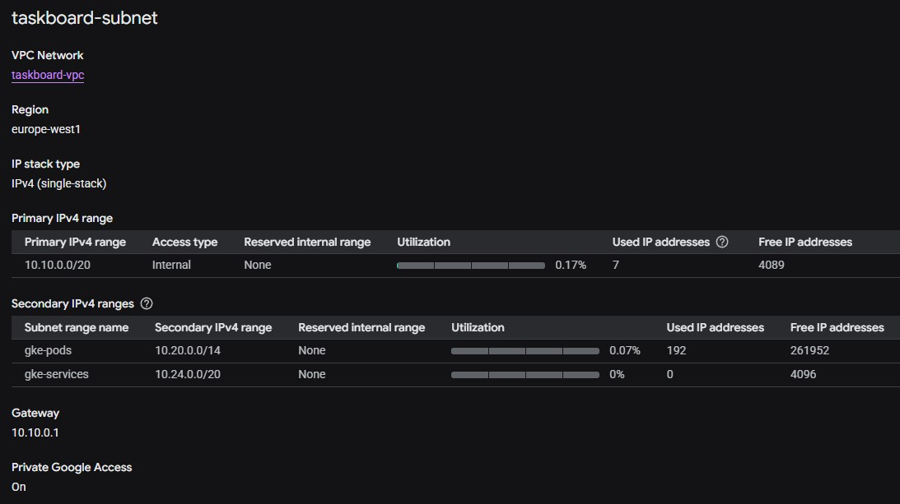
</p>

The OpenTofu state in its own GCS bucket — single `default.tfstate` under `tofu/state/`, in the same region as the rest of the infra:

<p align="center">
  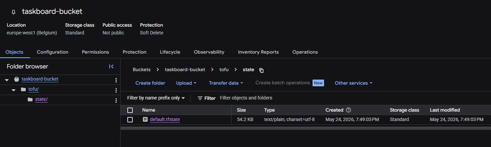
</p>

The Cloud DNS managed zone created by `network.tf`, holding the apex + `www` A records that point at the static Ingress IP. SOA and NS records are auto-managed; the registrar's NS entries were the one-time manual hand-off:

<p align="center">
  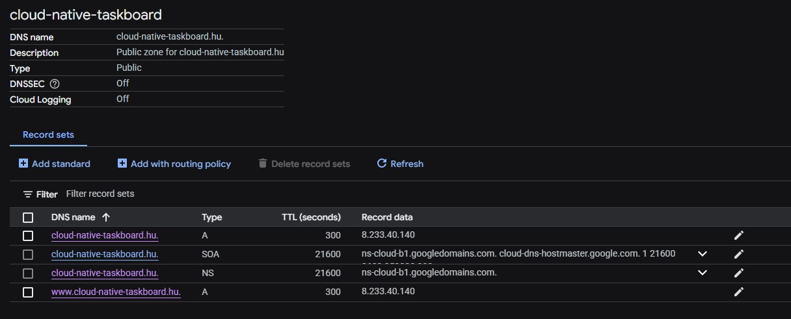
</p>

The Global HTTPS Load Balancer that the GKE Ingress provisions — HTTPS on `:443`, frontend pointing at the Google-managed certificate, single backend service in front of the frontend NodePort:

<p align="center">
  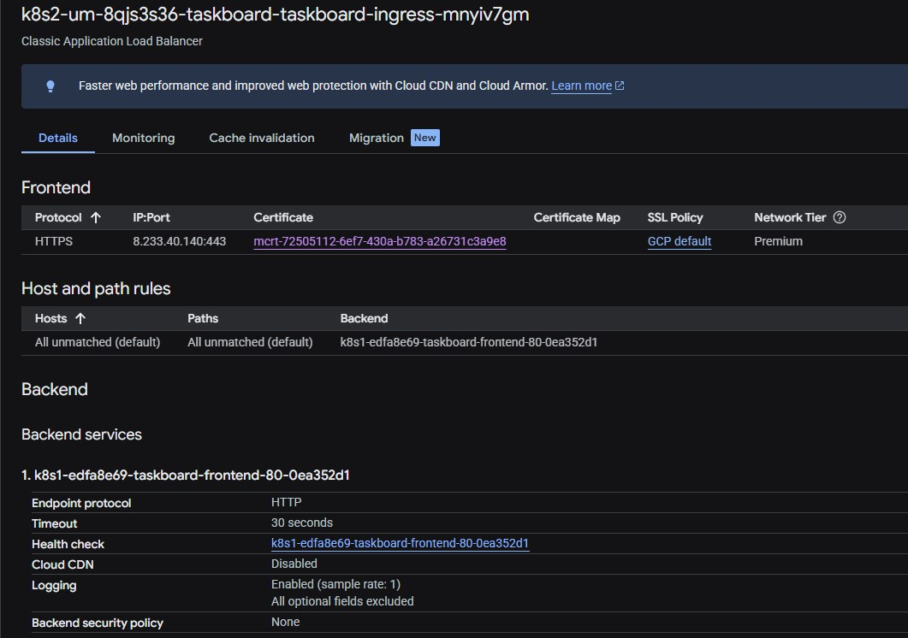
</p>

The Google-managed TLS certificate, ACTIVE for both `cloud-native-taskboard.hu` and `www.cloud-native-taskboard.hu`. No cert-manager, no Let's Encrypt plumbing — GCP renews it transparently:

<p align="center">
  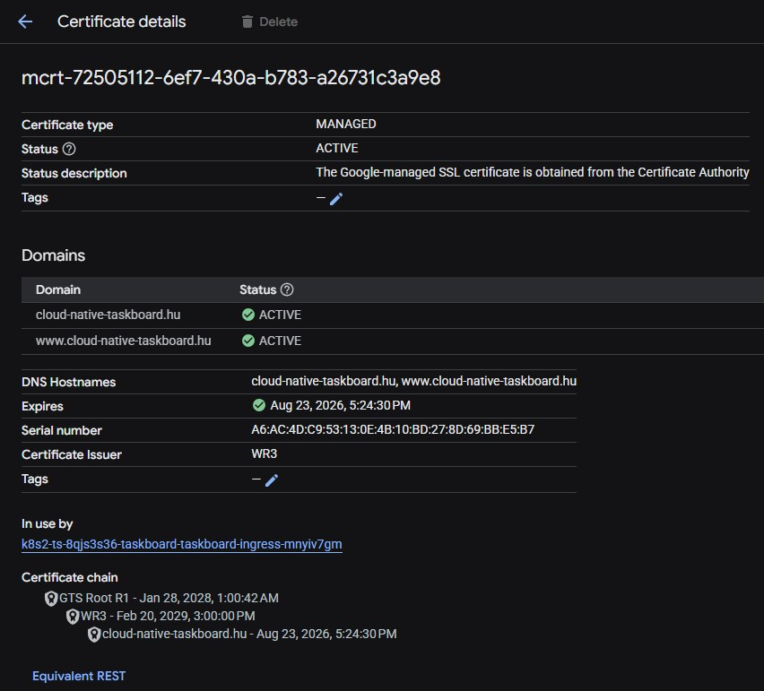
</p>

### Why this shape

* **GKE Autopilot over Cloud Run / VM** — microservices benefit from service discovery, declarative scaling, and standard manifests. Autopilot removes node-ops from scope.
* **Cloud SQL with private IP over self-hosted Postgres in a pod** — DBaaS gives backups, patching, HA option; private IP enforces a real boundary the grader can verify.
* **Workload Identity Federation over service account keys** — no long-lived credential anywhere. Trust is pinned to `attribute.repository == "<owner>/<repo>"` in the WIF pool provider.
* **OpenTofu over Terraform** — MPL-2.0, Linux Foundation governance, identical HCL and providers. Avoids the BSL licence concern.
* **Manifests in YAML instead of in Terraform** — earlier the cluster was managed by the `kubernetes` Terraform provider. That coupled cluster reachability into every `tofu plan` and made the deployer SA need cluster-wide perms. The current split lets infra and workloads be operated, reviewed, and authorised independently.

### Security model (the part most worth defending)

* **No secret value ever lives in tfstate.** Terraform creates only empty Secret Manager containers. The `google_sql_user.app` resource is given a throwaway bootstrap password with `lifecycle { ignore_changes = [password] }`; the real value is set with `gcloud sql users set-password` so it matches what is in Secret Manager. `scripts/bootstrap-secrets.sh` is the one-shot tool that seeds Secret Manager. The two Terraform-managed secret containers as they appear in the GCP console — names only, no values visible from a `tofu plan` or `tofu state pull`:

  <p align="center">
    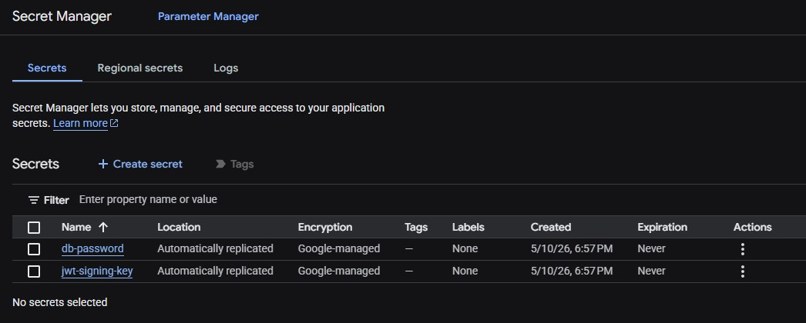
  </p>
* **No secret value ever lives in a Kubernetes `Secret`.** The CSI driver writes Secret Manager values directly to files on the pod, sourced through the `taskboard-pods` GSA. Nothing ends up in etcd.
* **The CI service account is narrow on purpose.** `github-deployer` has only `roles/artifactregistry.writer`, `roles/container.developer`, `roles/storage.objectAdmin` on the state bucket, `roles/cloudsql.viewer` (so manifests.yml can look up the DB private IP), and per-secret `roles/secretmanager.secretVersionAdder`. It **can rotate** secrets but **cannot read** them, **cannot create infra**, and **cannot grant itself more permissions**. Notably it does not have `roles/editor`, `roles/iam.securityAdmin`, or `roles/secretmanager.admin`.
* **Least privilege per pod.** Only api-gateway and users-service get a `JWT_SIGNING_KEY_FILE` env var pointing at the CSI mount; tasks-service does not, even though all pods mount the same CSI volume. (Per-secret volumes would give file-level isolation but add manifest churn — intentionally not implemented at this scope.)
* **Defence in depth.** Private cluster + private DB IP + ClusterIP-only backends + JWT validation at the single trust boundary (the gateway) + bcrypt cost 12 for passwords + `404`-on-ownership-mismatch to avoid leaking resource existence.
* **TLS by default.** `allow-http: "false"` on the Ingress and a Google-managed certificate on the apex + `www` domains.

### Running it

```bash
# One-time, manual: create the state bucket with versioning enabled.
gcloud storage buckets create gs://<state-bucket> --location=eu --uniform-bucket-level-access
gcloud storage buckets update gs://<state-bucket> --versioning

cd terraform/
tofu init -backend-config="bucket=<state-bucket>"
tofu apply           # full environment in ~10–15 min (GKE is the long pole)
tofu output          # WIF_PROVIDER, DEPLOYER_SA, ingress_ip, dns_nameservers, …

# One-time, manual hand-offs after first apply:
#   1. Point the registrar's NS records at the four Google nameservers from
#      `tofu output dns_nameservers`.
#   2. Run scripts/bootstrap-secrets.sh to seed the real secret values
#      (then `gcloud sql users set-password` so the DB matches).
#   3. Set GCP_PROJECT_ID, WIF_PROVIDER, DEPLOYER_SA as GitHub Actions
#      repository variables (Settings → Secrets and variables → Actions).
#   4. Push a `:bootstrap` image once per service so the first manifests apply
#      doesn't crash with ImagePullBackOff.

tofu destroy         # clean teardown
```

After everything is wired up, the four Deployments are healthy and running on private GKE nodes inside the `taskboard` namespace:

<p align="center">
  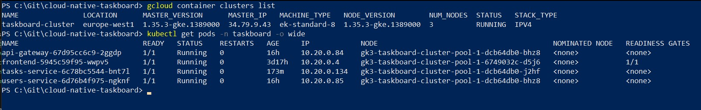
</p>

---

## 5. CI/CD

Two GitHub Actions workflows, no Jenkins, no extra runners. Both authenticate to GCP via Workload Identity Federation — there is no long-lived service account key, no `GOOGLE_APPLICATION_CREDENTIALS`, and no `GCP_SA_KEY` secret in GitHub.

```
   git push main
       │
       ├── changed under services/**  ──►  deploy.yml
       │                                  detect-changes → test → build → deploy
       │                                  └─ matrix per service (parallel)
       │                                  └─ docker build, push :<sha>
       │                                  └─ kubectl set image + rollout status
       │
       └── changed under manifests/** ──►  manifests.yml
                                          envsubst placeholders →
                                          preserve current image tags →
                                          kubectl apply -k
                                          (PRs run kubectl diff only)
```

### `.github/workflows/deploy.yml` — application rollout

Triggered on push to `main` touching `services/**`.

* **`detect-changes`** uses `dorny/paths-filter@v3` to determine which of `users-service`, `tasks-service`, `api-gateway`, `frontend` actually changed. Anything else short-circuits to a no-op — a frontend-only PR does not trigger a Go build.
* **`test`** spins up a Postgres 15 service container and runs `go test ./...` for each changed Go service. Failed tests stop the pipeline before any image is pushed.
* **`build`** authenticates via WIF, configures Docker for Artifact Registry, then builds and pushes an image tagged with the **exact git SHA** (`europe-west1-docker.pkg.dev/<project>/taskboard/<service>:<sha>`). No `:latest`.
* **`deploy`** fetches GKE credentials via WIF, runs `kubectl set image deployment/<svc> <svc>=<new-image> -n taskboard`, and waits on `kubectl rollout status --timeout=5m`. A pod that never reaches `Ready` fails the job — broken images are caught in CI, not in production.

A successful run of `deploy.yml` — the `detect-changes` job fans out into the `test`, `build`, and `deploy` matrices, with `frontend` short-circuited (`changed=false`) because only the Go services were modified in this commit:

<p align="center">
  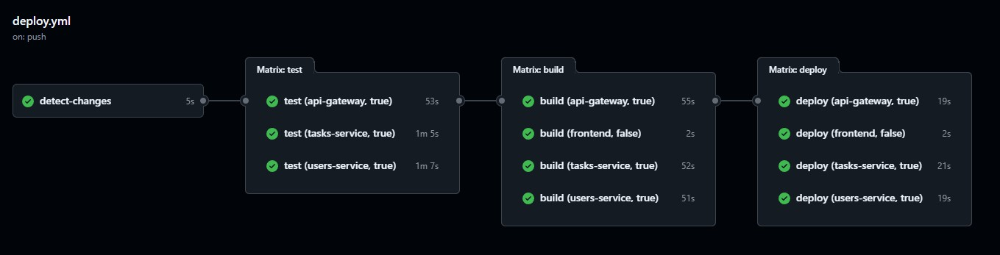
</p>

`set image` mutates only the image field, which is why the manifests workflow (which owns the rest of the Deployment spec) is careful to read each Deployment's currently-running image and rewrite the `:bootstrap` placeholder before applying — otherwise a topology change would silently roll the image back.

### `.github/workflows/manifests.yml` — topology apply

Triggered on push to `main` touching `manifests/**`, on PRs touching the same path (diff only), and on manual `workflow_dispatch`.

1. Authenticates via WIF.
2. Looks up runtime values: `DB_HOST` via `gcloud sql instances describe taskboard-postgres`, `PODS_GSA_EMAIL` and `REGISTRY` derived from `PROJECT_ID` and region.
3. `envsubst`'s those into a rendered copy of each manifest (the placeholder whitelist is explicit so unknown `$VAR`s don't get silently substituted).
4. Reads each Deployment's currently-running image and rewrites the rendered `${REGISTRY}/<svc>:bootstrap` so a topology apply does not roll back the live deploy.
5. On PRs: `kubectl diff -k rendered/`. On main / dispatch: `kubectl apply -k rendered/`.

A successful `render-and-diff` run showing each step — auth, runtime value lookup, envsubst rendering, GKE creds, and the conditional `kubectl diff` / `kubectl apply` branch (the `diff` step is skipped here because this run is on `main`, not a PR):

<p align="center">
  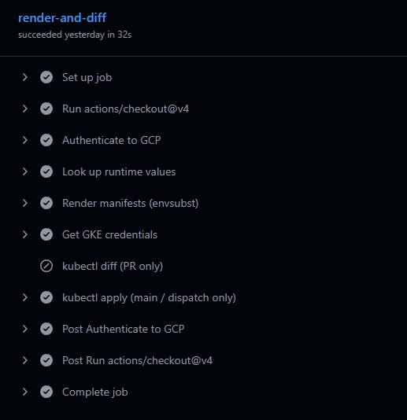
</p>

### Why infra has no workflow

Earlier the repo had a `tofu.yml` with PR-plan and gated-apply jobs. It was removed because the `github-deployer` SA was deliberately stripped of `roles/editor`, `roles/iam.securityAdmin`, and `roles/secretmanager.admin` to fix the "the CI principal can mutate everything" problem. With those gone, neither `tofu plan` (no project-wide read) nor `tofu apply` (no write) works from CI — which is the right outcome. Infrastructure changes are infrequent, high-impact, and run locally by an operator who already has admin credentials. The CI deployer SA only needs to push images, roll deployments, and rotate (not read) secrets.

### Authentication — Workload Identity Federation

```yaml
permissions:
  id-token: write       # required for the OIDC token GitHub mints
  contents: read

- uses: google-github-actions/auth@v2
  with:
    workload_identity_provider: ${{ vars.WIF_PROVIDER }}
    service_account: ${{ vars.DEPLOYER_SA }}
```

The WIF pool provider in `iam.tf` pins trust with `attribute.repository == "<owner>/<repo>"`. The deployer SA is bound to the principal set for that repository via `roles/iam.workloadIdentityUser`. No secret is shared between GitHub and GCP; the only material on the GitHub side is the public WIF provider name and SA email, stored as repo *variables* (not secrets).

### Required GitHub Actions repo variables

| Variable          | Value                                                |
| ----------------- | ---------------------------------------------------- |
| `GCP_PROJECT_ID`  | The GCP project ID                                   |
| `WIF_PROVIDER`    | Output of `tofu output -raw wif_provider`            |
| `DEPLOYER_SA`     | Output of `tofu output -raw deployer_sa_email`       |

### Rollback

Every image is git-SHA-tagged and pushed to Artifact Registry, so:

```bash
kubectl rollout undo deployment/users-service -n taskboard
```

immediately rolls back to the previous image. The previous image is still in Artifact Registry; the previous Deployment revision is still in the cluster.

---

## 6. Further improvement

The scope was deliberately bounded for one university term. Real next steps, roughly ordered by impact:

* **Multiple environments.** A `manifests/overlays/dev|prod/` Kustomize split with image tags, replica counts, and resource requests parametrised per environment. A second GCP project (or namespace) for staging would let manifest changes bake before reaching prod.
* **Observability stack.** Cloud Logging is on by default; add Cloud Monitoring uptime checks against `https://cloud-native-taskboard.hu`, structured Go logs (currently stdlib `log`), a Grafana / Cloud Monitoring dashboard, and trace propagation through the gateway (OpenTelemetry).
* **Refresh tokens and JWT key rotation.** HS256 + a 24h access token is fine for the assignment scope; a real product needs short access tokens, refresh tokens, and a key-rotation story (a key version field on the secret and a graceful overlap window in the gateway).
* **End-to-end browser tests in CI.** A small Playwright job in `deploy.yml` that hits the public LB after a deploy and walks the register → login → create board flow would catch broken images earlier than a `/healthz` ever can.
